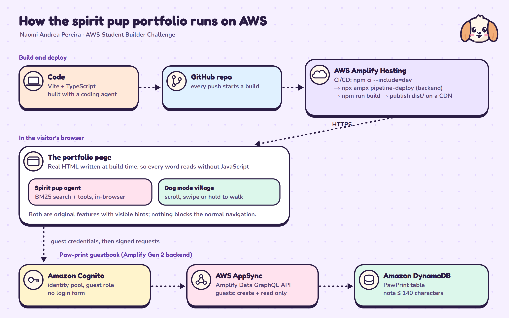

# Spirit Pup: a portfolio with a pup that is both a guide and a game

**Naomi Andrea Pereira** · Full Stack Developer and AI/ML Engineer · Bengaluru

- **Live site:** _add your Amplify URL here, for example https://main.xxxxxxxx.amplifyapp.com_
- **Code:** _add your GitHub repository link here_

> Everything in _italics_ above, and every paragraph marked ✏️, still needs your own words before you submit. The rest describes what the site really does.

## In one minute

- A kawaii Halloween portfolio with all the core sections: **About me, Education, Experience, Skills, Projects, Achievements** and Contact. Every word is real HTML, so it reads with or without JavaScript.
- **Creative feature: the spirit pup, with three tricks.** **Ask** it anything about me and it answers from my portfolio with a tiny retrieval agent written from scratch, then moves you around the page. Play **Fetch!**: pick a role or paste a job post, throw the ball, and the pup runs back with a one-page résumé tailored to it. Or **become the dog** and walk my village, where every building opens part of the portfolio.
- **On AWS:** hosted and built by **AWS Amplify Hosting** from GitHub, with an **Amplify Gen 2** guestbook on **AppSync**, **DynamoDB** and **Cognito**.
- **Checked:** mobile Lighthouse 98–99 performance, 100 accessibility, 100 best practices, 100 SEO; zero issues from the axe accessibility checker in light mode, dark mode, on a phone, in dog mode and with the chat open.

## ✏️ What I wanted it to feel like

I wanted my portfolio to feel like Halloween night in a cosy little village: a bit spooky, mostly cute, and full of things to poke. I also didn't want to only *list* my tech superpower. My focus is agentic systems and RAG, so I wanted the site to show one working.

## The creative feature: a spirit pup

The pup lives in the corner of every page and in the hero. It knows three tricks, and none of them gets in the way of the normal page.

### 1. Ask the pup: a tiny agent that only knows this page

Click **Ask the pup** (or the pup in the corner, which says "Ask me about Naomi!") and ask in plain words.

- **It answers from my real content.** At build time the site turns my content file into small passages: one per internship, project, award and skill group, plus education, my bio and contact links. When you ask something, the pup ranks those passages with **BM25**, a classic search-ranking formula implemented from scratch with light stemming and synonyms ("college" also finds "education", "won" also finds "award").
- **It shows its sources.** Every answer has "Found in" chips that jump to the section it came from.
- **It doesn't make things up.** If nothing matches, it says so. Ask about my favourite food and it replies that it couldn't find that on the page.
- **It's an agent, so it can act.** Before searching it checks whether you asked it to *do* something, and it has a few tools:
  - "Show me the blockchain projects" filters the Projects grid and scrolls there.
  - "Take me to the achievements" scrolls to Achievements. In dog mode, it walks the pup to the trophy hall instead.
  - "Turn the lights off" switches to the dark theme.
  - "Let me be the dog" starts dog mode, and "back to human" leaves it.
- **It runs entirely in the browser.** No API key, no server and no cost per question, and it still works if the network drops after the page loads. The chat code loads only when someone opens it.

Questions worth trying: *What does Naomi build? · Which projects use React? · Biggest hackathon wins? · Where does Naomi work now? · How was this site built?*

### 2. Fetch!: a résumé tailored to your job post

This one is for whoever is hiring. In the Fetch! section, pick a role (AI / ML engineer, Full-stack developer, Cloud & AWS, Blockchain) or paste a real job description, then press **Throw the ball**.

- The ball flies across a little yard, the pup chases it, and it trots back with a bone. The bone is a one-page résumé shaped to what you asked for:
  - the skills from my Skills list that your post mentions, highlighted;
  - my three best-matching projects, with demo and source links;
  - my internships ordered by relevance, each with the bullet point that fits best;
  - education, hackathon wins and contact links.
- **It never invents anything.** It only picks and reorders what is already on the page. The same BM25 search ranks the projects and internships. A skill matcher recognises spellings like "ReactJS", "sklearn" or "k8s", and ignores look-alikes such as "Series C" when looking for the C language. If nothing matches, it says so and shows my highlights instead.
- **Print or save as PDF** prints only the fetched résumé on a clean white page, ready to attach to a hiring note.
- The pasted text stays in the browser; nothing is sent anywhere.
- The chat knows the trick too: "Fetch a résumé for a cloud role" or "I'm hiring an ML engineer" plays fetch for you.

### 3. Become the dog: walk the village

**Become the dog** turns the page into a side-scrolling pastel village whose sky follows your local time: golden hour, dusk, or a moonlit night with stars.

- Each building opens the real section in a dialog:
  - the cottage is **About me**, the school is **Education**, the quest board is **Experience**;
  - the spell workshop is **Skills**, and the night market has a stall for every **project**;
  - the trophy hall is **Achievements** and the mailbox is **Contact**.
- Things only a dog would do: **sniff** (S) to see glowing scent trails, **dig** up buried notes that turn out to be my achievements, try on costumes (pumpkin, ghost, witch hat), and if you stop walking the pup sits, then curls up and snores.
- Opening the cottage, the workshop and the market lights three memory lanterns and plays a short ending.
- **Desktop:** scroll, arrow keys or A/D to walk.
- **Phone:** swipe sideways or hold the ◀ ▶ buttons next to the map. A hint explains this the first time.
- The mini-map shows where you are and jumps to any building. **Back to human** is always on screen, so the game can't trap anyone.

### Visible hints, and never in the way

- The hero has the Ask and Become the dog buttons side by side, with a one-line explanation that links to Fetch!. The corner pup greets visitors, and Fetch! has its own section right before Contact.
- The normal page, its navigation and every link work without touching either feature.
- If the browser asks for less motion, the animations stop but every feature still works.

### ✏️ Why this is me

My focus is agentic systems and RAG, and I've collected eight hackathon awards, three of them first place. So I wanted a creative feature that is both: a small agent that is honest about what it knows, wrapped in an original Halloween village you can walk around.

## The portfolio itself

- **About me:** my bio and quick facts (based in Bengaluru, focus on AI/ML, current internship at HPE, hackathon record).
- **Education:** Ramaiah Institute of Technology, B.E. Information Science and Engineering, CGPA 9.67.
- **Experience:** three internships (HPE, Samsung R&D Institute, Fintervue) on a winding "quest log", each with a hand-drawn badge.
- **Skills:** focus areas plus seven groups of tools and languages.
- **Projects:** six projects with filters (AI & ML, Cloud & AWS, Blockchain, Web apps), live demos and source links. RepoWatch, an always-on issue-triage agent on AWS Lambda and Amazon Bedrock, comes first.
- **Achievements:** eight hackathon results, three of them first place.
- **Contact:** GitHub and LinkedIn, plus a paw-print guestbook.

All personal text lives in one file, `src/content/portfolio.ts`. React renders it to static HTML at build time and is never sent to the browser. A few kilobytes of TypeScript add the interactions on top: a "lights out" theme, pumpkins and a ghost to poke in the hero, project filters, and the two pup features. Every illustration is an original SVG drawing.

## AWS: how it's built and hosted



| Service | What it does here |
| --- | --- |
| **AWS Amplify Hosting** | Connected to the GitHub repo. Every push runs the build in `amplify.yml`, then serves the site over HTTPS from a global CDN. |
| **Amplify Gen 2** | Defines the guestbook backend in TypeScript (`amplify/`) and deploys it in the same pipeline with `npx ampx pipeline-deploy`. |
| **AWS AppSync** | The GraphQL API for the guestbook, generated from the `PawPrint` model. |
| **Amazon DynamoDB** | Stores each paw: a note of at most 140 characters and the costume the pup was wearing. |
| **Amazon Cognito** | An identity pool gives visitors temporary guest credentials, so there's no login form and no API key that can expire. |

The build spec:

```yaml
backend:
  phases:
    build:
      commands:
        - npm ci --cache .npm --prefer-offline --include=dev
        - npx ampx pipeline-deploy --branch $AWS_BRANCH --app-id $AWS_APP_ID
frontend:
  phases:
    build:
      commands:
        - npm run build
  artifacts:
    baseDirectory: dist
```

Choices worth noticing:

- **Guests are limited.** They can only create and read paws, never edit or delete them. The 140-character limit is checked in the schema and in the form, and the browser waits 30 seconds between paws.
- **The agent costs nothing to run.** It runs in the visitor's browser, so a judge asking fifty questions costs zero server time.
- **Nothing depends on the backend.** If the backend isn't deployed, the guestbook simply doesn't appear and the rest of the site works.

## Screenshots to attach

From `npm run screenshots` (saved in `screenshots/`):

- `human-1440-hero.png`: the hero with both ways to explore.
- `human-1440-chat.png`: the pup filtering projects and refusing to invent an answer.
- `human-1440-fetch.png`: Fetch! with a pasted job post and the résumé it brought back.
- `human-1440.png`: the whole page.
- `human-1440-dark.png`: lights out.
- `human-390-hero.png` and `human-390.png`: the phone layout.
- `dog-1440.png`, `dog-1440-sniff.png`, `dog-1440-about.png` and `dog-1440-ending.png`: dog mode.
- `dog-390.png`: dog mode on a phone with the walk buttons.
- `docs/architecture.png`: the diagram above.

From the AWS console (take these yourself after deploying):

- the Amplify app with a successful build and its domain;
- the AppSync API;
- the DynamoDB `PawPrint` table with a few paws in it;
- the Cognito identity pool.

## What I learned

- **Retrieval first, words second.** Building BM25 from scratch made the "R" in RAG concrete. Most of the pup's quality came from the passages, not the ranking: one passage per project or award beats one big blob of text. Synonyms mattered more than stemming.
- **An agent is mostly routing.** The useful part was deciding *what to do* before *what to say*: filter, scroll, switch the theme, walk the pup. Returning actions separately from the text kept the logic testable.
- **Honesty is a feature.** A fixed "I couldn't find that" answer made the pup more trustworthy than any clever guess.
- **Creative layers sit on top of readable HTML.** The page is rendered at build time, so judges, screen readers and search engines all read the same content. Dog mode moves the real sections into a dialog rather than copying them.
- **Amplify Gen 2 guest access** is `allow.guest().to(['create', 'read'])` with the identity pool as the auth mode. The auth resource still exists even with no sign-in, so the identity pool can be created.
- **Phones need their own controls.** Scroll-to-walk was natural with a mouse and confusing on a phone until it had walk buttons, sideways swipes and a one-time hint.

✏️ _Add a sentence or two in your own words about what surprised you most._

## Challenges

- **Vertical scrolling, horizontal world.** Phones scroll up and down, but the village is sideways. A tall invisible scroller maps scroll position to the pup's place in the world. The buildings then sat under that scroller, so clicks hit it instead of a house; the scroller now forwards each click to whatever is underneath.
- **The pup couldn't reach the end of the village on wide screens.** The camera stopped at the world's edge. Now the pup's position comes from the scroll, and the camera follows it and stops at the edges, so the pup reaches the far fence on any screen.
- **Holding a key felt stuck.** Keyboard walking used smooth scrolling, and each keypress cancelled the last animation. Walking keys now move the position straight away, and the camera eases toward it.
- **Scroll-in animations can hide content from anyone who doesn't scroll,** including an automated full-page screenshot. Cards are visible by default and only animate when they're about to come into view.
- **Amplify's build image sets `NODE_ENV=production`,** so a plain `npm ci` skipped Vite and the Amplify CLI. The build spec installs with `--include=dev`.
- **Keeping the agent honest.** Early answers stitched together unrelated passages. Now answers only combine passages from the same section that score close to the best match, and anything below a threshold gets the honest "I couldn't find that".

✏️ _Tell the one challenge you remember best, in your own voice._

## What's next

- Give the pup a voice with **Amazon Bedrock** behind an Amplify function. It would keep the same retrieval step, so generated answers stay grounded in the page.
- Fill in the project graveyard with honest stories about unfinished projects.
