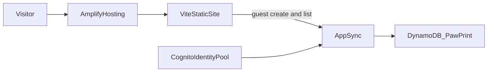

# Submission draft — Spirit Pup Portfolio

[Your words: one or two sentences in your own voice about what you wanted this site to feel like.]

## The creative feature, and why a dog

The portfolio is a normal page first. About, skills, projects, achievements, and contact are HTML you can read without playing anything. The creative feature is opt-in: a **Become the dog** button with a paw, and a puppy in the corner.

Dog mode turns the same page into a side-scrolling village at dusk. Scrolling walks a spirit pup. The cottage is About, the lantern workshop is Skills, the night market has one stall per project, the crooked mailbox is Contact, and the graveyard has a stone per unfinished project. Walking up to a building opens the real section in a dialog. A mini-map jumps to any building, and **Back to human** is always on screen, so the game cannot trap anyone.

A dog, rather than a person walking past signs, because the mechanics are things a dog does. Sniffing shows scent trails to buried notes. Digging turns up achievements and lines from the bio. Sitting still long enough makes the pup curl up with Zzz. Paw prints follow the cursor on a desktop. The skills list is a spirit journal: each group is a small original creature, and booping one keeps it.

The pup is not a claim about a real pet. The bio does not name a dog, so the character is an original spirit who wandered into Naomi’s village on Halloween night. Lighting the cottage, the workshop, and the market plays a short ending that quotes the existing bio. The drawings are original. They use soft shapes, big eyes, and a warm palette. They do not copy film characters.

[Your words: why this felt like you — clean code, bold design, AI work, Bengaluru, the hackathon streak, or something else only you can say.]

## AWS

- **Amplify Hosting** builds the Vite site from GitHub and serves the static files. `amplify.yml` runs the Gen 2 backend deploy, then `npm run build`, and publishes `dist`.
- **Amplify Gen 2 Data** defines a `PawPrint` model in TypeScript. Amplify creates an AppSync API and a DynamoDB table.
- **Amazon Cognito** provides an identity pool. The site never shows a login. Anonymous visitors use the unauthenticated guest role, which is the current Amplify recommendation for public data because API keys expire.
- Guests may create and read paws. They cannot update or delete them. The note is required and limited to 140 characters in the schema and in the form. The browser also refuses a second paw for 30 seconds.
- If the backend has not been deployed, there is no `amplify_outputs.json` and the guestbook is not rendered. The portfolio still works.

[Your words: what you want a judge to notice about this architecture, in a sentence or two.]

## What I learned

[Your words: start here with what you actually took from the build. The notes below are a draft of the technical lessons.]

- A creative layer has to sit on top of readable HTML. Moving the existing sections into a dialog kept one copy of the text for screen readers and for anyone who never clicks the dog.
- Amplify Gen 2’s guest rule is `allow.guest().to(['create', 'read'])` with `authMode: 'identityPool'`. The auth resource still exists so the identity pool can be created, even when the UI has no sign-in.
- `prefers-reduced-motion` has to turn off the delightful parts without turning off the navigation. The village still scrolls, the map still jumps, and the panels still open.
- Self-hosting the Latin subsets of Fredoka and Nunito kept the first load small. The human-mode JavaScript bundle is a few kilobytes. GSAP and the village load only after **Become the dog**.

## Challenges

These are problems from the build, not a list of missing features.

- The village wants vertical scrolling, because that is what a phone already does, but the scene is horizontal. A tall invisible scroller maps scroll position to the world. The buildings then sat underneath that scroller, so a click landed on the scroller instead of a house. The scroll surface forwards the click to whatever is underneath.
- The pup stays on screen while the world moves. The “you are at the cottage” test used the pup’s real position on screen. Before that measurement, the open button could offer a buried note when the visitor was standing at the door.
- Keyboard walking used a smooth scroll. A second keypress cancelled the first animation before the position changed, so holding D felt stuck. Walking keys now move the scroll position immediately.
- The opening’s first frame hid the porch, because the animation started the basket fully transparent. The porch is visible as soon as the scene starts, and Skip is there the whole time.
- The sticky nav covered the headings it linked to. The sections now leave room for the nav when you jump to them.
- about-me.txt lists CGPA as 9.67 in Education and 9.63 under Achievements. The page shows 9.67 so it does not print two scores. [Your words: which number is right, if you want to say so.]
- Vite 8’s config loader warned about imports without file extensions. Those imports now include `.ts`.
- Amplify’s build image sets `NODE_ENV=production`. A plain `npm ci` then skips devDependencies, so Vite and the Amplify CLI would be missing. The build spec installs with `--include=dev`.
- On a phone the corner puppy sat on top of the skills and project text. The narrow layout now keeps a gutter for that hint.
- The sit pose swung the legs out sideways. Sitting now lowers the body and only folds the legs a little.
- A gold focus ring disappears on the cream cards. Focus is now a dark outline with a gold halo.

[Your words: the challenge you want to tell in your own voice. A good one is the moment the dog and the text had to be the same page, or the first time the village worked on a phone.]
